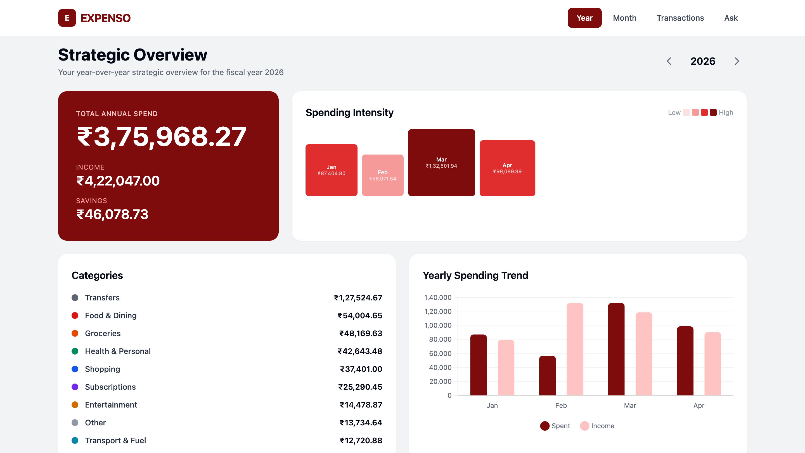
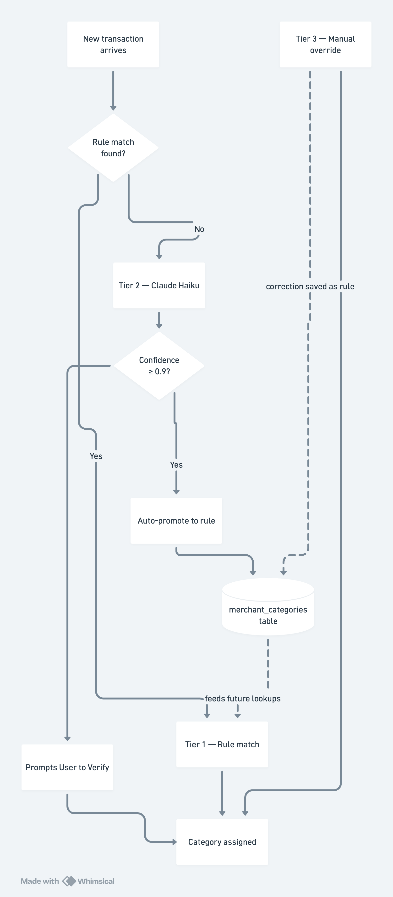
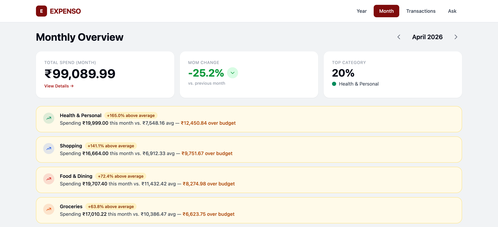
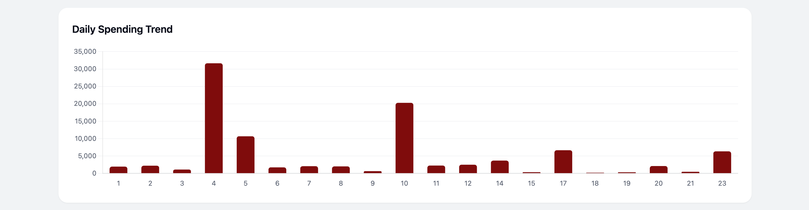
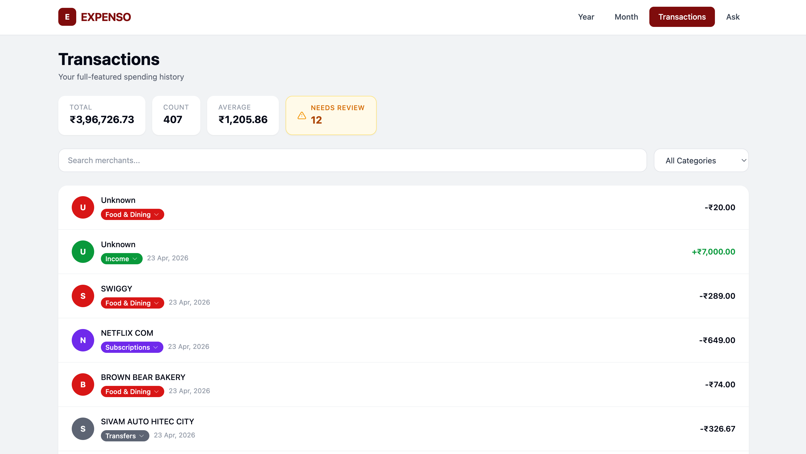
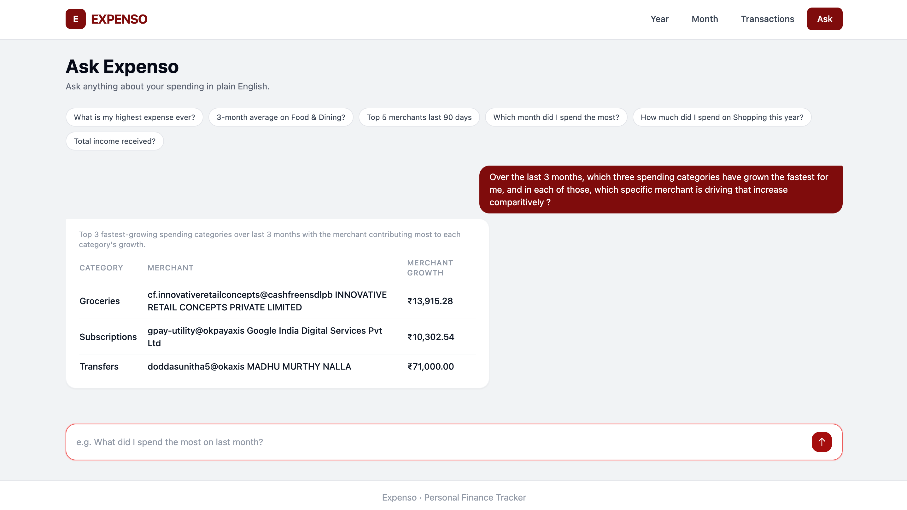
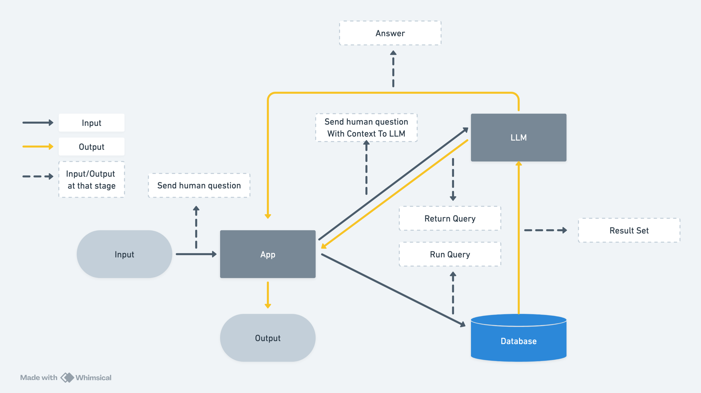
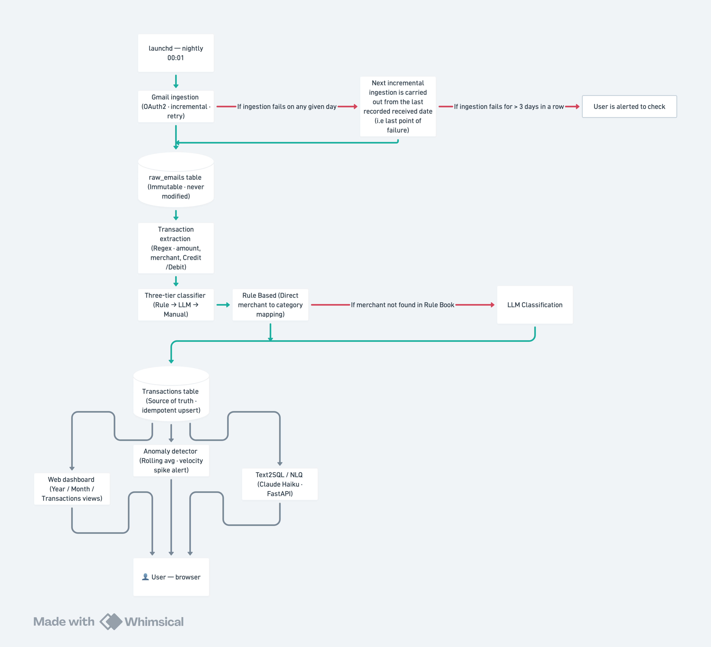

# Expenso

A fully automated personal finance tracker that ingests Bank transaction emails from Gmail, extracts and categorises every transaction, and surfaces insights through a clean web dashboard — including anomaly detection and a plain-English query interface.

---

## Dashboard

*Annual overview: total spend, income, savings, variable-size spending intensity heatmap, and a monthly bar chart.*

---

## Features

### Automated Email Ingestion → Transaction Extraction
Connects to Gmail via OAuth2 and fetches HDFC Bank alert emails incrementally (only since the last stored date). Each email is regex-parsed to extract amount, date, direction, merchant, source, and UPI reference. Only confirmed `success` transactions are stored — failed and attempted are discarded.

### Three-Tier Classification Engine
Every transaction is assigned to one of 10 categories through a self-learning pipeline:

- **Tier 1 — Rule-based:** Substring match against a `merchant_categories` table (74+ patterns). Instant, confidence = 1.0.
- **Tier 2 — LLM fallback:** Claude Haiku classifies unmatched merchants and returns a confidence score. Results ≥ 0.9 are auto-promoted to rules for future use.
- **Tier 3 — Manual override:** Inline category editing from the Transactions page. Every correction is auto-learned as a new rule.

### Monthly Dashboard with Anomaly Callouts

Flags categories spending >50% above their 3-month rolling average (with a minimum ₹500 absolute deviation) as amber callout cards. Stats cards show total spend, month-over-month % change, and top category share.

### Transactions with Low-Confidence Flagging

Live search, category filter, and paginated table. Transactions classified by the LLM with confidence < 0.9 are flagged with a **"Low Confidence — verify"** indicator and an amber row highlight. Correcting the category inline clears the flag and auto-learns the rule.

### Natural Language Query Bot

Ask anything about your spending in plain English. The system translates it to SQL via Claude Haiku, executes it against PostgreSQL, and returns a formatted answer. Supports complex multi-step analytical queries using CTEs.

Example questions:
- *"What is my highest expense ever?"*
- *"Over the last 3 months, which three spending categories have grown the fastest, and which merchant is driving each?"*
- *"Top 5 merchants last 90 days"*
- *"Which month did I spend the most?"*

All generated SQL is validated (SELECT/WITH only, no DDL), capped at 50 rows, and executed with an 8-second timeout.

### Nightly Automation
A macOS launchd job runs four phases at 00:01 every night — ingestion, extraction, classification, and a staleness health check that sends a macOS notification if no emails have been ingested for 3+ days.

---

## System Architecture

**Key design principles:**
- **Immutability** — Raw emails are never modified. Transactions are re-derivable from them.
- **Idempotency** — All inserts use `ON CONFLICT DO NOTHING / DO UPDATE`. Re-running any phase is safe.
- **Self-healing** — Incremental ingestion means a missed night auto-catches up the next run.
- **Conservative accounting** — Only `status = 'success'` transactions are ever stored.

---

## Tech Stack

| Layer | Technology |
|---|---|
| Backend | FastAPI + Uvicorn |
| Templating | Jinja2 |
| Frontend interactivity | HTMX 2.0.4 (no JS framework) |
| CSS | Tailwind CSS |
| Charts | Chart.js |
| Database | PostgreSQL + psycopg2 |
| Gmail integration | Google API Python Client (OAuth2) |
| AI | Anthropic Claude Haiku (`claude-haiku-4-5-20251001`) |
| Scheduling | macOS launchd |
| Language | Python 3.13 + Poetry |

---

> For a full technical deep-dive — schema, data flow, and architecture decisions — see [PRODUCT.md](PRODUCT.md).
